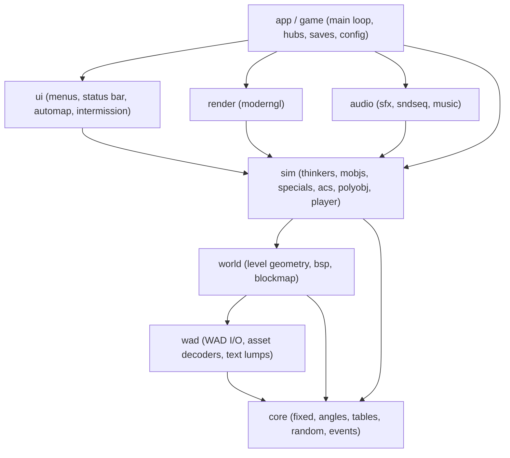
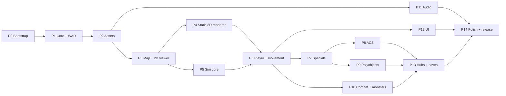

# PyHexen — Implementation Plan

> **Audience:** any AI coding agent or human developer. Each task in §7 is self-contained:
> it lists its dependencies, the reference source to read, what to deliver, and acceptance
> criteria that can be checked.
> **Workflow and rules:** see `../AGENTS.md`. **Status:** see `PROGRESS.md`.

---

## 1. Goal and scope

Build a **faithful, modern, cross-platform reimplementation of the Hexen engine in Python**
that plays the original *Hexen: Beyond Heretic* campaign from a user-supplied `HEXEN.WAD`.

| In scope (v1.0) | Out of scope (v1.0; possible stretch goals) |
|---|---|
| Full single-player campaign, all 3 classes, all hubs | Multiplayer / netcode |
| Faithful gameplay (35 Hz deterministic tic simulation) | Vanilla demo-sync compatibility (stretch S1) |
| GPU renderer with authentic 8-bit palette/colormap look | Dynamic lights, HD textures, true 3D models |
| Mouse look, widescreen, modern resolutions | Deathkings expansion beyond "loads as PWAD" (S3) |
| Original SFX, sound sequences, MIDI music | CD audio tracks |
| Menus, status bar, automap, intermission, saves | Editor tools |
| Windows first; Linux/macOS should work | Mobile / web |

**Fidelity target:** the gameplay matches the reference (Chocolate Doom's Hexen) in feel
and rules. Exact demo sync is a stretch goal, but the architecture (fixed point, original RNG,
thinker order) is chosen so it stays achievable.

---

## 2. Technology stack

| Concern | Choice | Notes |
|---|---|---|
| Language | **Python 3.12+** | `uv` for env/deps |
| Window, input, audio mixer | **pygame-ce** | `pygame.display.set_mode(..., OPENGL \| DOUBLEBUF)` |
| Rendering | **moderngl** (OpenGL 3.3 core) | Shaders in `render/shaders/*.glsl` |
| Math / bulk data | **numpy** | Asset decoding, mesh building |
| Hot loops (optional) | **numba** | Only after profiling; must have pure-Python fallback |
| Polygon triangulation | **mapbox_earcut** | Sector floors/ceilings |
| Music | MUS→MIDI (own code) → `pygame.mixer.music`; optional **pyfluidsynth** + SF2 | Pluggable backend |
| Config | TOML (`tomllib` read, `tomli-w` write) | `config.toml` next to exe / user dir |
| Tests | **pytest**, `pytest-benchmark` (perf) | Markers: `wad`, `gl`, `slow` |
| Lint/format | **ruff** | Optional `mypy --strict` for `core/`, `wad/` |
| Packaging | **PyInstaller** (Nuitka optional later) | Never bundle game data |
| Reference source | **Chocolate Doom** `src/hexen/` + `src/` (GPL-2.0) | Pinned tag, cloned to `reference/` |

---

## 3. Architecture

### 3.1 Layering (imports go downward only)



- **`sim` never imports `render`, `audio` or `ui`.** It emits events (`SoundEvent`,
  `SectorChanged`, `PrintMessage`, `MapExit` and so on) into an `EventBus` in `core/events.py`.
  Front-ends subscribe to it.
- The renderer reads simulation state (mobjs, sectors, polyobjs) **read-only** and keeps its own
  GPU-side caches.

### 3.2 Repository layout

```
pyhexen/
  AGENTS.md  README.md  LICENSE  pyproject.toml  config.example.toml  .gitignore
  docs/      IMPLEMENTATION_PLAN.md  PROGRESS.md  DECISIONS.md
  tools/     fetch_reference.ps1/.sh  gen_tables.py  gen_info.py  report_actions.py
  reference/ (gitignored) chocolate-doom checkout
  src/pyhexen/
    __main__.py                 # CLI entry: --iwad --file --warp --skill --class --fly ...
    core/    fixed.py angles.py tables_data.py (generated) random.py events.py ticcmd.py
    wad/     wadfile.py namespaces.py palette.py picture.py textures.py flats.py sprites.py
             sounds.py mus.py scanner.py mapinfo.py sndinfo.py sndseq.py animdefs.py maplumps.py
    world/   level.py geometry.py bsp.py blockmap.py reject.py
    sim/     game_sim.py thinker.py mobj.py info_data.py (generated) actions/ (by subsystem)
             maputl.py map.py movement.py sight.py player.py pspr.py inter.py enemy.py
             specials/ (dispatcher.py doors.py floors.py ceilings.py plats.py pillars.py
                        lights.py teleport.py switches.py anim.py scroll.py sector_specials.py)
             acs/ (loader.py vm.py pcodes.py store.py)
             polyobj.py
    render/  context.py renderer.py textures.py mesh_walls.py mesh_flats.py chunks.py
             sprites.py psprites.py sky.py overlay2d.py camera.py shaders/
    audio/   sfx.py channels.py sndseq_player.py mus2mid.py music.py
    ui/      fonts.py hud.py statusbar.py menu.py messages.py automap.py intermission.py finale.py
    app/     main_loop.py game.py hub.py savegame.py config.py input.py
    tools/   wadinfo.py mapview2d.py
  tests/
    fixtures/wadbuilder.py      # synthetic WAD/map generator (CI-safe)
    unit/ integration/ wad/      # wad/ = requires real IWAD (marker `wad`)
```

### 3.3 Main loop and timing

- **Fixed-timestep simulation at 35 Hz** with an accumulator. Render as fast as vsync allows.
- Rendering **interpolates** between the previous and current tic state: mobj positions and
  angles, sector heights, polyobj transforms. Every mobj stores `prev_x/y/z/angle`, captured at
  the start of each tic.
- Input is sampled per frame and turned into a **`TicCmd`** per tic. The fields match the
  original: `forwardmove`, `sidemove`, `angleturn`, `lookfly`, `arti`, `buttons`. Because the
  `TicCmd` stream is the only input into `sim`, demo recording and determinism testing come
  for free.
- Mouse yaw is applied to the camera at frame rate (for smoothness), then quantised into
  `angleturn` for the sim.

### 3.4 Numeric conventions

| Quantity | Representation |
|---|---|
| Positions, heights, velocities | Python `int`, 16.16 fixed (`FRACUNIT = 1 << 16`) |
| Angles | Python `int`, 32-bit BAM (`ANG90 = 0x40000000`), always `& 0xFFFFFFFF` |
| Trig | Lookup tables `finesine`/`finecosine`/`finetangent`/`tantoangle` generated from reference `tables.c` |
| Division / modulo | `c_div`, `c_mod` (truncate toward zero), never raw `//` on signed values |
| Render side | `float32` (`fixed / 65536.0`) |

**Coordinate mapping to OpenGL:** map `(x, y, z)` becomes GL `(x, z, -y)`, with 1 map unit =
1 GL unit. An optional "authentic pixel aspect" mode scales the world vertically by 1.2 to
reproduce 320×200 non-square pixels. A config flag controls it.

### 3.5 Rendering design (GPU, authentic palette look)

1. **Textures** are decoded to 8-bit **indexed** `R8` GPU textures, plus a separate mask
   (or reserved transparent handling) for patches and sprites. **All shading happens in the
   fragment shader:** `color = PLAYPAL[pal][ COLORMAP[light_row][ index ] ]`. This gives
   authentic banding, damage/pickup palette flashes (PLAYPAL 1..13), and fog maps (FOGMAP)
   for free. Use nearest filtering. An optional "smooth" mode converts to RGBA with linear
   filtering.
2. **Light diminishing**: emulate the software renderer's light model in the shader using
   sector light level and view distance. Derive the constants (`LIGHTLEVELS`,
   `LIGHTSEGSHIFT`, `MAXLIGHTSCALE`, `LIGHTSCALESHIFT`, `MAXLIGHTZ`, `LIGHTZSHIFT`,
   `NUMCOLORMAPS`) from reference `r_local.h`/`r_main.c`. Walls and flats use slightly
   different curves in the original; reproduce that difference.
3. **Geometry**: static level geometry is grouped into **per-sector chunks** (one VBO
   range per sector for its flats plus the wall pieces owned by its lines). When the sim
   reports `SectorChanged(i)`, the chunks of sector `i` and its neighbours are rebuilt on the CPU
   (ADR-004). Polyobjects are separate small meshes with a model matrix.
4. **Walls**: upper, middle and lower pieces follow Doom pegging rules (`DONTPEGTOP`,
   `DONTPEGBOTTOM`), side x/y offsets, two-sided masked middles (no vertical tiling, clipped
   to the opening), and the sky hack (no upper wall between two sky ceilings). Check every
   rule against `r_segs.c`.
5. **Flats**: trace sector boundary loops, then triangulate with earcut (holes supported).
   *Fallback* for broken sectors: per-subsector convex polygons built by clipping with BSP
   partition half-planes and segs. UVs are world-aligned 64×64.
6. **Sky**: polygons with the sky flat (`F_SKY`) are drawn with a **screen-space sky shader**
   that samples the sky texture by view yaw and pitch, like the original. It supports Hexen
   **double sky** (`sky1`/`sky2` with scroll speeds from MAPINFO) and **lightning** flashes.
7. **Sprites**: camera-facing billboards. Rotation frames (1–8 or 0) and mirroring are chosen
   per frame on the CPU and batched per texture. Translucent and shadow actors use alpha
   blending, sorted back to front after the opaque pass.
8. **Look up/down**: the default is the authentic **y-shearing** done through the projection
   matrix. A true-pitch perspective option is available (ADR-006).
9. **2D overlay** (status bar, menus, weapon sprites) is drawn in a 320×200 virtual space with
   aspect-correct scaling, using the same palette shader.
10. **Authentic mode** renders into a low-resolution framebuffer (e.g. 320×200 or 640×400)
    and upscales with nearest filtering.

Depth buffering replaces the original's visplane/clipping logic. The BSP is still needed for
the simulation (`R_PointInSubsector`, sight checks) but not for rendering order.

### 3.6 Simulation design

- A `GameSim` owns one `Level` plus the thinker list, players, ACS state and polyobjects. There
  are **no module-level globals**, which makes testing, save games and hub snapshots simple.
- **Info tables** (`states[]`, `mobjinfo[]`, sprite names, enums) are **generated** by
  `tools/gen_info.py` from reference `info.c`/`info.h` into `sim/info_data.py`. Action
  functions are bound by name through a registry (`@action("A_Chase")`). Missing actions resolve
  to a logging stub, and `tools/report_actions.py` lists what's left to implement.
- Thinkers are a doubly linked list (or an ordered list with tombstones), run in the original
  order. Removal is deferred like the original, which marks thinkers as removed and unlinks
  them later.
- **Line specials** (Hexen style: `special` + 5 `args`) run through a single dispatcher,
  `P_ExecuteLineSpecial`. Line activation type (SPAC) comes from linedef flags.
- **ACS VM** interprets `BEHAVIOR` bytecode. Scripts are thinkers. The ACS store queues
  scripts for maps that aren't loaded yet within the hub.
- **Hubs**: on leaving a map inside a cluster, the full map state is serialised and kept in
  memory (or on disk). Re-entering restores it. Changing cluster discards the stored maps.

### 3.7 Save game format

Explicit, versioned serialisation (`to_state()` / `from_state()` on every persistent class).
Object references are stored as indices (mobj index, sector index and so on). Files are
compressed with `zlib` and carry a header holding the format version, map and IWAD checksum.
Pickle is **not** used (ADR-005). Hub snapshots reuse the same mechanism.

---

## 4. Hexen-specific knowledge (things that differ from Doom)

> Byte layouts below are summaries; **verify against reference** `xddefs.h`, `p_setup.c` and
> the Doom Wiki before relying on them.

- **WAD container:** a 12-byte header (`IWAD`/`PWAD`, int32 lump count, int32 directory
  offset), then 16-byte directory entries (int32 offset, int32 size, 8-char name). All values
  are little-endian. Name lookup returns the **last** match (PWAD override).
- **Map lumps (Hexen format):** marker `MAPxx`, then `THINGS`, `LINEDEFS`, `SIDEDEFS`,
  `VERTEXES`, `SEGS`, `SSECTORS`, `NODES`, `SECTORS`, `REJECT`, `BLOCKMAP`, **`BEHAVIOR`**.
  - THINGS (20 bytes): tid, x, y, z(height), angle, type, flags (int16 each); special (u8);
    args[5] (u8).
  - LINEDEFS (16 bytes): v1, v2, flags (u16); special (u8); args[5] (u8); front/back side (u16,
    0xFFFF = none).
  - SIDEDEFS (30), VERTEXES (4), SEGS (12), SSECTORS (4), NODES (28; child bit 15 means
    subsector), SECTORS (26). These are the same as Doom.
- **Linedef flags:** blocking, block-monsters, two-sided, dont-peg-top, dont-peg-bottom,
  secret, sound-block, dont-draw, mapped, **repeat-special (0x0200)**, **SPAC activation in
  bits 10–12** (cross, use, monster-cross, impact, push, projectile-cross).
- **Thing flags:** skill bits (easy, normal, hard), ambush, **dormant**, **class filters
  (fighter, cleric, mage)**, **game-mode filters (single, coop, deathmatch)**.
- **Text lumps:** `MAPINFO` (map names, cluster/hub, next, warptrans, sky1/sky2,
  doublesky, lightning, fadetable, music), `SNDINFO` (logical sound names to lumps),
  `SNDSEQ` (door/platform/polyobj sound sequences), `ANIMDEFS` (texture/flat animations;
  Hexen has no `ANIMATED`/`SWITCHES` lumps). They're parsed by a port of the `sc_man.c`
  tokenizer.
- **Graphics:** `PLAYPAL` (14 palettes × 768), `COLORMAP`, **`FOGMAP`** (use lump size / 256
  for the row count), Doom picture format for patches and sprites, `PNAMES` + `TEXTURE1`
  (plus `TEXTURE2` if present), 64×64 raw flats between `F_START`/`F_END`, sprites between
  `S_START`/`S_END`.
- **Audio:** DMX digital sound lumps (format 3, rate, count, unsigned 8-bit PCM, possibly with
  padding), and music in **MUS** format (convert to MIDI, see reference `src/mus2mid.c`).
- **Polyobjects:** moving and rotating wall groups defined by anchor and spawn things plus
  `Poly_StartLine`/`Poly_ExplicitLine` linedef specials (`po_man.c`).
- **Hubs:** clusters of maps with persistent state; `Teleport_NewMap` carries a position
  argument.
- **Player classes:** Fighter, Cleric and Mage, each with four weapons (the 4th assembled from
  pieces), **blue/green mana**, class-specific armor values, an inventory of artifacts, and
  puzzle items.
- **Other Hexen features:** jumping, flying (Wings of Wrath), look up/down, terrain types
  (water/lava/sludge splashes and floor clipping), lightning, sound sequences, thing IDs
  (TIDs) for scripting, dormant things, glass and destructible decorations.

---

## 5. Testing strategy

| Level | What | Runs in CI? |
|---|---|---|
| Unit | fixed math, tables, RNG, WAD parsing, decoders, scanner, ACS ops, mus2mid | ✅ |
| Synthetic integration | Small maps built by `wadbuilder.py`: movement/collision, doors, ACS scripts, polyobjs, save round-trip | ✅ |
| Determinism | Record `TicCmd`s, replay twice, and compare per-tic **state hashes** (positions, health, sector heights, RNG index) | ✅ (synthetic) / local (real WAD) |
| Real-data (`wad`) | Load every map in the IWAD without errors; decode every lump; golden screenshots for key views (local only, not committed) | ❌ local |
| GL (`gl`) | Headless moderngl context renders a synthetic room; pixel checks | Optional |
| Manual playtest | Checklist per hub in `PROGRESS.md` | ❌ |

**State hash:** `sim.state_hash()` returns a stable hash (e.g. `blake2b`) over the ordered tuple
of all mobj `(type, x, y, z, angle, health, state index)`, all sector `(floor, ceil, light)`,
polyobj transforms, and the RNG index. It's used by the determinism, save round-trip and demo
tests.

---

## 6. Milestones



| Milestone | Demo-able outcome |
|---|---|
| **M1** (end of P3) | `wadinfo` lists and exports assets; the 2D map viewer shows any Hexen map |
| **M2** (end of P4) | Fly through MAP01 in 3D with correct textures, lighting and sky |
| **M3** (end of P7) | Walk MAP01 with collision; doors, lifts and switches work |
| **M4** (end of P10) | Fight monsters with all three classes; pick up items |
| **M5** (end of P13) | Play through the first hub with ACS puzzles, hub travel and save/load |
| **M6** (end of P14) | Full campaign playable, packaged Windows build |

After P3, the **P4, P5, P11 and P12 tracks can be worked in parallel** by different agents.

---

## 7. Task list

Format per task: **Deps**, **Ref** (paths are relative to `reference/src/hexen/` unless
prefixed `src/`), **Deliver**, **Accept**. Reference file names refer to the Chocolate Doom
layout; verify them in the pinned checkout.

### P0 — Bootstrap

**T0.1 Repository scaffold**
- Deps: none.
- Deliver: `pyproject.toml` (uv, deps from §2, ruff config, pytest markers `wad`, `gl` and
  `slow`), `src/pyhexen/__init__.py`, `__main__.py` printing its version, a `LICENSE` file
  (full GPL-2.0 text), `README.md`, `.gitignore` (`*.wad`, `*.WAD`, `reference/`, `out/`,
  `*.sf2`, saves, `config.toml`), and `config.example.toml`.
- Accept: `uv sync`, `uv run python -m pyhexen --version`, `uv run pytest` (0 tests ok) and
  `uv run ruff check .` all succeed.

**T0.2 Reference source fetch**
- Deps: T0.1.
- Deliver: `tools/fetch_reference.ps1` and `.sh` to shallow-clone chocolate-doom at a pinned
  release tag into `reference/`, with the tag recorded in `DECISIONS.md` (ADR-002).
- Accept: running the script leaves `reference/src/hexen/p_map.c` in place, and running it
  again is idempotent.

**T0.3 Config and IWAD discovery**
- Deps: T0.1.
- Deliver: `app/config.py` (resolution order: CLI, then env `PYHEXEN_IWAD`, then
  `config.toml`), and a `tests/conftest.py` fixture `iwad_path` that skips `wad` tests when no
  IWAD is configured.
- Accept: unit tests cover the resolution order, and `pytest -m wad` skips cleanly without an
  IWAD.

**T0.4 CI**
- Deps: T0.1.
- Deliver: a GitHub Actions workflow (Windows + Ubuntu, Python 3.12) running ruff and pytest
  (excluding `wad` and `gl`).
- Accept: the workflow passes on an empty project.

**T0.5 Synthetic WAD builder**
- Deps: T0.1.
- Deliver: `tests/fixtures/wadbuilder.py`. It writes PWADs/IWADs with arbitrary lumps, and
  has a `MapBuilder` that creates Hexen-format maps from rectangles, sectors, lines and things.
  It should generate a valid simple BSP (a single subsector per convex sector is acceptable;
  document any limits), a BLOCKMAP and a zero REJECT. It can also add synthetic
  PLAYPAL/COLORMAP and generated patterns for textures.
- Accept: round-trip tests (build, then parse with T1.4 once it exists) are enabled in T1.4.

### P1 — Core and WAD I/O

**T1.1 Fixed-point math**
- Deps: T0.1. Ref: `src/m_fixed.c`, `src/m_fixed.h`.
- Deliver: `core/fixed.py` with `FRACBITS`, `FRACUNIT`, `fixed_mul`, `fixed_div` (with the
  original overflow clamp), `c_div`, `c_mod`, `to_int32`, `to_int16`, `to_uint32`, `abs32`.
- Accept: property tests against a C-semantics reference implementation covering negatives,
  overflow and boundaries.

**T1.2 Trig tables and angles**
- Deps: T1.1, T0.2. Ref: `src/tables.c`, `src/tables.h`, `r_main.c` (`R_PointToAngle2`).
- Deliver: `tools/gen_tables.py` (parses the reference tables into
  `core/tables_data.py`), and `core/angles.py` (`ANG45..ANG270`, `ANGLETOFINESHIFT`,
  `FINEANGLES`, `point_to_angle2`, `approx_distance`).
- Accept: the generated table lengths and sample values match the reference;
  `point_to_angle2` matches the C algorithm on 10k random cases (via a pure-Python port of the
  slope-div logic).

**T1.3 Random**
- Deps: T0.2. Ref: `m_random.c`.
- Deliver: `core/random.py` with the 256-entry table, a `Random` class (separate `prnd` and
  `rnd` indices), `p_random()`, `m_random()`, `p_subrandom()` if used, `clear()`, and state
  get/set for saves.
- Accept: the first 512 values after clear match the reference sequence.

**T1.4 WAD reader**
- Deps: T0.5. Ref: `src/w_wad.c`.
- Deliver: `wad/wadfile.py` (mmap-backed `WadFile`, a `WadStack` merging an IWAD and PWADs,
  `find(name)` returning the last match, `get_bytes`, `find_all`, `lumps_between(start, end)`)
  and `wad/namespaces.py` (sprites, flats and patches, handling `S_`/`SS_` and `F_`/`FF_`
  marker variants).
- Accept: synthetic WAD round-trip tests pass. A `wad` test opens the real IWAD, finds
  `PLAYPAL`, `MAP01` and `BEHAVIOR`, and counts lumps.

### P2 — Assets and text lumps

**T2.1 Palette and colormaps**
- Deps: T1.4. Ref: `r_data.c`, `v_video`.
- Deliver: `wad/palette.py` returning `PLAYPAL` as an `(N,256,3) uint8` array, plus
  `COLORMAP`/`FOGMAP` as `(rows,256) uint8`. Include a PNG debug export (via pygame) in
  `tools/wadinfo`.
- Accept: shapes are verified on synthetic and real data.

**T2.2 Picture decoder**
- Deps: T1.4. Ref: `r_data.c`, `r_things.c` (picture format: width, height, offsets, column
  pointers, posts).
- Deliver: `wad/picture.py` with `decode_picture(bytes) -> Picture(indices: uint8[h,w],
  mask: bool[h,w], left, top)`. Malformed data must be rejected safely.
- Accept: synthetic pictures round-trip; all sprites and patches in the real IWAD decode
  without exception (`wad` test).

**T2.3 Composite wall textures**
- Deps: T2.2. Ref: `r_data.c` (`R_InitTextures`, `R_GenerateComposite`).
- Deliver: `wad/textures.py` parsing `PNAMES` and `TEXTUREx`, composing patches into
  `Texture(name, w, h, indices, mask)` with lazy caching, plus a name→index map. Index 0 is
  the "no texture" (`-`) entry.
- Accept: synthetic tests; every real texture composes; a debug PNG export works.

**T2.4 Flats**
- Deps: T1.4. Ref: `r_data.c`.
- Deliver: `wad/flats.py`, which loads 64×64 flats from the namespace into a name→index map.
- Accept: tests; the real IWAD flat count is logged.

**T2.5 Sprite frame registry**
- Deps: T2.2, T5.1 (sprite names; it may use a temporary hard-coded list until T5.1 exists).
  Ref: `r_things.c` (`R_InitSpriteDefs`).
- Deliver: `wad/sprites.py` mapping `sprite -> frames -> 8 rotations (lump, flip)`, handling
  rotation 0 and the mirrored second frame/rotation in lump names.
- Accept: synthetic tests for rotation and mirroring rules; every real sprite resolves.

**T2.6 Script scanner and MAPINFO**
- Deps: T1.4. Ref: `sc_man.c`, `p_setup.c` (`InitMapInfo`), `g_game.c`.
- Deliver: `wad/scanner.py` (a port of `sc_man.c` covering strings, numbers, comments and
  `SC_MustGetString` semantics), and `wad/mapinfo.py` producing a `MapInfo` dataclass list
  (name, cluster, next/secret, warptrans, sky1/2 and speeds, doublesky, lightning, fadetable,
  cdtrack, music).
- Accept: unit tests with synthetic MAPINFO text; the real MAPINFO parses with the expected
  map count.

**T2.7 SNDINFO, SNDSEQ and ANIMDEFS**
- Deps: T2.6. Ref: `s_sound.c` (`S_InitScript`), `sn_sonix.c`, `p_anim.c`.
- Deliver: parsers in `wad/sndinfo.py`, `wad/sndseq.py` (sequence opcodes as data) and
  `wad/animdefs.py` (texture/flat animations, including random tic ranges).
- Accept: synthetic tests; the real lumps parse.

**T2.8 wadinfo CLI**
- Deps: T2.1–T2.7.
- Deliver: `python -m pyhexen.tools.wadinfo` with `list`, `extract <lump>`, `export-png
  <texture|flat|sprite|patch> --out out/` and `maps` (MAPINFO table) subcommands. Output goes
  to `out/` (gitignored).
- Accept: the commands work on the real IWAD. **Milestone M1, part 1.**

### P3 — Map loading and 2D viewer

**T3.1 Map lump parsers**
- Deps: T1.4. Ref: `p_setup.c`, `xddefs.h`.
- Deliver: `wad/maplumps.py`, which parses all Hexen map lumps into numpy structured arrays
  (fast) with documented dtypes. Detect the Doom format (no `BEHAVIOR`) and reject it with a
  clear error.
- Accept: synthetic map round-trip; every real map parses.

**T3.2 Level construction**
- Deps: T3.1, T1.1. Ref: `p_setup.c` (`P_LoadVertexes`… `P_GroupLines`).
- Deliver: `world/level.py` with `Level`, `Sector`, `Line`, `Side`, `Seg`, `Subsector` and
  `Node` (slots dataclasses, fixed-point coordinates), plus derived data: line dx/dy, bbox,
  slopetype, front/back sectors, sector line lists, sector bbox and sound origin, and
  subsector→sector.
- Accept: invariants are tested (every two-sided line has a back sector, and so on); the real
  maps load.

**T3.3 BSP and blockmap**
- Deps: T3.2. Ref: `r_main.c` (`R_PointInSubsector`, `R_PointOnSide`), `p_setup.c`
  (blockmap), `p_maputl.c` (`P_BlockLinesIterator`).
- Deliver: `world/bsp.py`, `world/blockmap.py` (including `validcount` semantics) and
  `world/reject.py`.
- Accept: point-in-subsector is correct on synthetic maps; the blockmap line iterator visits
  the expected lines.

**T3.4 2D map viewer**
- Deps: T3.2, T2.6.
- Deliver: `python -m pyhexen.tools.mapview2d --warp MAP01` (pygame, no GL), with lines coloured
  by type (one-sided, two-sided, special, polyobj), things as dots coloured by category,
  pan/zoom, and a hover tooltip showing line/thing/sector info.
- Accept: a manual check on several maps. **Milestone M1 complete.**

### P4 — Static 3D renderer

**T4.1 GL bootstrap and main loop**
- Deps: T0.3.
- Deliver: `render/context.py` (pygame-ce window + moderngl context, resize, vsync toggle),
  `app/main_loop.py` (35 Hz accumulator with an interpolation alpha), `render/camera.py`
  (free-fly camera, shear-based look up/down), and an FPS overlay.
- Accept: the window opens, a test triangle renders, and the loop logs a steady 35 tics/s.

**T4.2 GPU texture manager**
- Deps: T4.1, T2.1, T2.3, T2.4.
- Deliver: `render/textures.py` uploading indexed `R8` textures and masks, a palette texture
  (256×14 RGB), and colormap/fogmap textures. Also an animation indirection table
  (texture index → current frame) updated per tic from ANIMDEFS.
- Accept: a debug view shows any texture correctly coloured through the palette shader.

**T4.3 Wall mesh builder**
- Deps: T4.2, T3.2. Ref: `r_segs.c`, `r_bsp.c`.
- Deliver: `render/mesh_walls.py` producing upper, middle, lower and masked-middle quads with
  correct pegging, offsets and sky-hack. Data is laid out per sector chunk (see T4.7).
- Accept: unit tests on synthetic sectors check UVs for each pegging case; a visual check on
  MAP01.

**T4.4 Flat mesh builder**
- Deps: T4.2, T3.3.
- Deliver: `render/mesh_flats.py` (loop tracing + earcut, BSP-clip fallback, flagging which
  sectors used the fallback), with world-aligned UVs.
- Accept: a synthetic sector with a hole triangulates correctly; 100% of real-map sectors
  produce non-empty geometry (report fallback count).

**T4.5 Palette and lighting shader**
- Deps: T4.2. Ref: `r_main.c` (`R_InitLightTables`), `r_plane.c`, `r_segs.c`.
- Deliver: `render/shaders/world.vert/.frag` implementing colormap-row selection from sector
  light and distance (separate wall/flat curves), fullbright, fog map selection, palette-flash
  index, and gamma.
- Accept: a side-by-side screenshot comparison with Chocolate Doom (by eye) on 3 reference
  views, with notes in PROGRESS.

**T4.6 Sky**
- Deps: T4.5, T2.6. Ref: `r_plane.c`, `p_anim.c` (lightning), `r_main.c` (sky).
- Deliver: `render/sky.py` + shader: screen-space sky with double layer and scrolling, plus a
  lightning flash hook that brightens sectors.
- Accept: the sky looks right in MAP01 and in a doublesky map.

**T4.7 Sector chunks and dynamic rebuild**
- Deps: T4.3, T4.4.
- Deliver: `render/chunks.py` with a per-sector VBO range and `mark_sector_dirty(i)` that
  rebuilds sector `i` and its neighbouring wall pieces on the next frame.
- Accept: a test raises a sector floor in a synthetic map, and the mesh updates in under 2 ms
  per sector.

**T4.8 Fly mode and screenshots**
- Deps: T4.6, T4.7.
- Deliver: `python -m pyhexen --iwad … --warp MAP01 --fly`, with F12 saving a screenshot to
  `out/`.
- Accept: **Milestone M2**. You can fly through every map without crashes or missing geometry.

### P5 — Simulation core

**T5.1 Info table generator**
- Deps: T0.2. Ref: `info.c`, `info.h`.
- Deliver: `tools/gen_info.py` producing `sim/info_data.py` (sprite names, state tuples
  `(sprite, frame, tics, action_name, next_state, misc1, misc2)`, mobjinfo dataclass
  entries, enums as `IntEnum`), plus `sim/actions/__init__.py` with an `@action` registry and
  stubs, and `tools/report_actions.py`.
- Accept: the generated counts match the reference; the report lists every action name with its
  implemented/stub status.

**T5.2 Thinkers and ticker**
- Deps: T5.1. Ref: `p_tick.c`.
- Deliver: `sim/thinker.py` (ordered list, deferred removal) and `sim/game_sim.py`
  (`GameSim.tick(cmds)`, level time, event bus wiring, `state_hash()` skeleton).
- Accept: unit tests cover order preservation and removal during iteration.

**T5.3 Map objects**
- Deps: T5.2, T3.3. Ref: `p_mobj.c`, `p_maputl.c` (`P_SetThingPosition`,
  `P_UnsetThingPosition`), `p_things.c` (TID hash).
- Deliver: `sim/mobj.py` with `Mobj` (all original fields that are needed), `spawn_mobj`,
  `set_mobj_state` (including the zero-tic state loop and action calls), `remove_mobj`,
  sector and blockmap linking, the TID map, and prev-state capture for interpolation.
- Accept: synthetic tests cover spawn, state cycling and removal.

**T5.4 Map thing spawning**
- Deps: T5.3. Ref: `p_setup.c`, `p_mobj.c` (`P_SpawnMapThing`), `po_man.c` (spawn markers).
- Deliver: spawning with skill, class and game-mode filtering, player starts, and dormant and
  ambush flags. Polyobj and special things are deferred to their systems.
- Accept: a `wad` test checks thing counts per skill/class on MAP01 against a log produced by
  the reference (or documented expected values).

**T5.5 Sprite rendering**
- Deps: T5.3, T2.5, T4.5.
- Deliver: `render/sprites.py` with billboard batching, rotation and flip selection,
  interpolation, sector light, fullbright frames, and translucent/shadow passes with sorting.
- Accept: in fly mode, MAP01 things appear in the correct places and facings.

### P6 — Player and movement

**T6.1 Input → TicCmd**
- Deps: T4.1. Ref: `g_game.c` (`G_BuildTiccmd`).
- Deliver: `app/input.py` (configurable bindings, mouse look, run/strafe, inventory keys,
  jump, fly up/down) and `core/ticcmd.py`.
- Accept: unit tests map synthetic events to the expected TicCmds.

**T6.2 Map utilities**
- Deps: T3.3, T1.2. Ref: `p_maputl.c`.
- Deliver: `sim/maputl.py` with `point_on_line_side`, `box_on_line_side`, `line_opening`,
  `intercept_vector`, `path_traverse` (intercepts, early-out), and the blockmap thing iterator.
- Accept: tests on synthetic geometry, including the classic edge cases.

**T6.3 Collision and movement**
- Deps: T6.2, T5.3. Ref: `p_map.c`, `p_mobj.c` (`P_XYMovement`, `P_ZMovement`).
- Deliver: `sim/map.py` and `sim/movement.py` with `check_position`, `try_move`,
  `PIT_CheckLine`/`PIT_CheckThing`, slide move, step-up, drop-off, friction, gravity, floor
  clipping (terrain), and crossed-line special collection.
- Accept: synthetic tests cover walking into walls (sliding), stairs, too-high steps and
  doorway fits.

**T6.4 Player thinker**
- Deps: T6.3, T6.1. Ref: `p_user.c`.
- Deliver: `sim/player.py` with `P_PlayerThink`, `P_MovePlayer`, view height and bob,
  look up/down, jump, fly, and death camera. The renderer camera follows the player with
  interpolation.
- Accept: walking around MAP01 feels right, with a short note comparing it to Chocolate Doom.

**T6.5 Line activation**
- Deps: T6.3. Ref: `p_spec.c` (`P_ActivateLine`), `p_map.c` (`P_UseLines`), `p_mobj.c`
  (impact).
- Deliver: SPAC handling (cross, use, monster-cross, impact, push, projectile-cross),
  repeatable flag, and use-line tracing. It calls the dispatcher (T7.1; stub until then).
- Accept: synthetic tests check that the right SPAC fires for each action.

### P7 — Sector and line specials

**T7.1 Special dispatcher**
- Deps: T6.5. Ref: `p_spec.c` (`P_ExecuteLineSpecial`), `p_spec.h`.
- Deliver: `sim/specials/dispatcher.py`, a table of all special numbers → handlers (with
  unimplemented ones logged), plus tag/sector iteration helpers and a `SectorChanged` event.
- Accept: a report lists the specials still missing.

**T7.2 Doors** (`p_doors.c`): open/close/raise, locked doors with key checks and messages,
and sound sequences. Accept: synthetic door tests; MAP01 doors work.

**T7.3 Floors and stairs** (`p_floor.c`): all floor movers, Hexen stair builders, donut,
and floor waggle. Accept: synthetic tests per mover type.

**T7.4 Ceilings and crushers** (`p_ceilng.c`). Accept: crusher damage and stop/resume tests.

**T7.5 Plats and pillars** (`p_plats.c`, `p_floor.c` pillars). Accept: synthetic tests.

**T7.6 Lights** (`p_lights.c`, lightning in `p_anim.c`): fade, glow, flicker, strobe and
lightning. Accept: light values over time match the reference formulas in tests.

**T7.7 Teleports and thing specials** (`p_telept.c`, `p_things.c`): Teleport,
Teleport_NoFog, Thing_Activate/Deactivate/Remove/Spawn/Projectile/Destroy, and
Teleport_NewMap (emits a `MapExit` event; hub logic comes in T13). Accept: synthetic tests.

**T7.8 Switches, animations and scrolling** (`p_switch.c`, `p_anim.c`, `p_spec.c`):
the hard-coded Hexen switch list, switch textures and sounds, ANIMDEFS ticking, and
scrolling walls and floors. Accept: tests; a visual check.

**T7.9 Sector specials** (`p_spec.c`, `P_PlayerInSpecialSector`, `P_SpawnSpecials`):
damage floors, secrets, wind and current pushers, and light-type sector specials.
Accept: tests. **Milestone M3.**

### P8 — ACS

**T8.1 BEHAVIOR loader** (`p_acs.c`): header, script directory (open scripts flagged by
number offset), string table. Accept: hand-built BEHAVIOR fixtures parse, and all real maps
load.

**T8.2 VM core**: a stack machine with map and world variables, arithmetic, logic and control
flow pcodes, and `delay`. The interpreter runs per script per tic, with a budget guard against
infinite loops. Accept: unit tests cover every pure pcode with hand-assembled bytecode.

**T8.3 Game pcodes**: line specials (direct and stack forms), thing count, tag/poly/script
waits, print/printbold (`PrintMessage` events), sound, sector and line texture changes, ambient
sounds, game type and skill queries, and line/thing activator semantics. Accept: synthetic map
tests for each group.

**T8.4 Script lifecycle and ACS store**: `ACS_Execute`, `ACS_Suspend`, `ACS_Terminate`,
`ACS_LockedExecute`, open scripts at map start, and a deferred store for other maps in the hub.
Accept: tests, and the MAP01 opening scripts run.

### P9 — Polyobjects

**T9.1 Polyobj spawn** (`po_man.c`): anchor, spawn and crush things; line collection via
start-line chains and explicit lines; translation to the anchor; mirror polyobjs.
Accept: synthetic polyobj tests; real maps spawn every polyobj without error.

**T9.2 Polyobj movement**: rotate, move, and poly doors (slide/swing); blocking and pushing
or crushing mobjs; mirror propagation; sound sequences; and the wait conditions used by ACS.
Accept: synthetic tests; a swinging door in MAP01 works.

**T9.3 Polyobj rendering**: dynamic meshes with model transforms, plus interpolation.
Accept: a visual check.

### P10 — Combat, monsters, weapons and items

**T10.1 Damage and death** (`p_inter.c`): `P_DamageMobj`, `P_KillMobj`, pain chance,
Hexen death variants (gib, ice, burn), thrust, and armor absorption by class.

**T10.2 Attacks** (`p_map.c`, `p_mobj.c`): `P_AimLineAttack`, `P_LineAttack`, puffs and
blood, missiles (spawn, check, explode), radius damage, ripper and seeker missiles.

**T10.3 Sight** (`p_sight.c`): reject plus the sight trace, matching the reference.

**T10.4 Monster AI base** (`p_enemy.c`): look, chase, move, new chase direction,
melee/missile range checks, sound alerting (`P_NoiseAlert`, sound-block lines).

**T10.5 Monster actions, batched by monster** (`a_action.c`, `p_enemy.c`): use
`tools/report_actions.py` to generate the checklist in PROGRESS.md. Suggested batches:
(a) common actors (Ettin, Afrit, Centaur, Chaos Serpent, Wendigo, Stalker),
(b) casters (Dark Bishop, Reiver, Slaughtaur variants),
(c) bosses and endgame (Death Wyvern, Heresiarch, the three class bosses, Korax).

**T10.6 Weapon framework** (`p_pspr.c`): psprites, raise/lower, ready/refire, mana use,
the 4th weapon assembled from pieces, and psprite rendering (`render/psprites.py`).

**T10.7 Fighter weapons**, **T10.8 Cleric weapons**, **T10.9 Mage weapons**
(`p_pspr.c` and the class-specific action files in the reference).

**T10.10 Items and inventory** (`p_inter.c`, `p_user.c` `P_UseArtifact`): pickups,
mana, armor pieces, keys, puzzle items, artifacts and their effects (including
morph/porkalator, flight, speed, invulnerability, torch, healing radius, summon).

**T10.11 Environment actors**: decorations, destructibles (glass, pots, trees),
bridges, ambient effects, and leaf/fire spawners.
- Accept for all of P10: `tools/report_actions.py` shows **0 stubs**; synthetic combat
  tests pass; a playtest of the first hub with each class. **Milestone M4.**

### P11 — Audio

**T11.1 SFX decode** (`audio/sfx.py`): DMX lumps → resample to the mixer rate (numpy) →
`pygame.mixer.Sound`, with caching. Accept: every real SFX decodes.

**T11.2 Sound system** (`s_sound.c`): channel limits, priorities, distance attenuation, stereo
separation and the full-volume radius per the reference, SNDINFO mapping, and per-mobj
origins following moving actors. It consumes `SoundEvent`. Accept: unit tests on volume/pan
math; listening checks.

**T11.3 Sound sequences** (`sn_sonix.c`): a SNDSEQ interpreter for doors, plats and polyobjs,
the sequence override things, and ambient sound things. Accept: synthetic tests on sequence
timing.

**T11.4 MUS→MIDI** (`src/mus2mid.c`): `audio/mus2mid.py`. Accept: synthetic MUS converts
to a valid MIDI that `mido` (a dev-only dependency) parses; every real track converts.

**T11.5 Music backend** (`audio/music.py`): a pygame mixer MIDI backend with an optional
fluidsynth + user-supplied SF2 backend, and per-map music from MAPINFO/SNDINFO.
Accept: music plays on Windows and changes with the map.

### P12 — UI

**T12.1 Fonts and the 2D overlay**: Hexen font lumps (see `mn_menu.c`), a text renderer,
and a 320×200 virtual canvas with aspect-correct scaling (`render/overlay2d.py`).

**T12.2 Status bar and inventory bar** (`sb_bar.c`): health chain, mana gauges, armor,
weapon pieces, inventory selection, plus a fullscreen HUD option.

**T12.3 Messages** (`ct_chat.c`/`p_user.c` message handling): player messages, ACS print, and
centred bold messages.

**T12.4 Menus** (`mn_menu.c`): main, class select, skill, options (video, audio, controls,
key rebinding), save/load slots, and quit confirmation.

**T12.5 Automap** (`am_map.c`): an overlay or fullscreen map, follow mode, zoom, and
mapped/unmapped rules.

**T12.6 Intermission and finale** (`in_lude.c`, `f_finale.c`): hub text screens, the end
sequence, title screen and the demo/advisory loop.
- Accept for P12: every screen can be navigated with keyboard and mouse; screenshots go in
  PROGRESS notes (local).

### P13 — Hubs and save games

**T13.1 Map transitions** (`g_game.c`, `h2_main.c`): exit and secret exit,
`Teleport_NewMap` with position, warptrans lookup, skill/class persistence, and the
inventory/key carry-over rules between hubs.

**T13.2 Serialization framework** (`sv_save.c` as a reference for *what* to save):
`to_state`/`from_state` for mobjs, thinkers (all special movers), sectors, lines, sides
(textures and offsets), polyobjs, ACS scripts and variables, players, RNG and level time.
Accept: `state_hash` is equal after a save→load round-trip on synthetic and real maps.

**T13.3 Hub persistence**: snapshot on leaving, restore on re-entry, and clear on cluster
change, including deferred ACS store scripts. Accept: a test in a synthetic two-map hub
checks that a door left open stays open.

**T13.4 Save/load UI and files**: slots, descriptions, compressed versioned files, and IWAD
checksum validation. Accept: saving and loading across a restart works. **Milestone M5.**

### P14 — Polish and release

**T14.1 Demo recording and determinism harness**: an own demo format (header plus TicCmd
stream), `--record` and `--playdemo`, and a CI test replaying synthetic demos to compare
state hashes.

**T14.2 Options**: resolution, fullscreen, FOV, authentic low-res mode, pixel-aspect
correction, true pitch vs shear, filtering, mouse sensitivity and invert, all persisted in
`config.toml`.

**T14.3 Performance pass**: profile MAP01 and the busiest maps, move hot paths to numpy or
numba, and meet the §AGENTS budgets. Record the results in PROGRESS.

**T14.4 Packaging**: a PyInstaller spec, a Windows one-folder build, a first-run IWAD locator
dialog, and a crash log file. Never include game data.

**T14.5 Full playthrough**: a hub-by-hub checklist for each class, with bugs filed as new
tasks `T14.5.x`. **Milestone M6.**

### Stretch goals
- **S1** Vanilla demo sync (built-in `DEMO1..3` playback matching the original).
- **S2** Multiplayer (coop/deathmatch using lockstep TicCmd exchange).
- **S3** Deathkings of the Dark Citadel support and PWAD loading tested.
- **S4** Mod support (custom MAPINFO/ACS PWADs).
- **S5** Visual extras (dynamic lights, optional smooth filtering, widescreen status bar).

---

## 8. Risks and mitigations

| Risk | Mitigation |
|---|---|
| Python too slow for simulation with many monsters | Fixed point on Python ints is acceptable; profile early (T6.4+); numba for `path_traverse`, `check_position` and the blockmap iterators; keep the data layouts numba-friendly |
| Mesh rebuilds stutter with many moving sectors | Per-sector chunks (ADR-004); if needed, move to the GPU-side sector-height texture approach (future ADR) |
| Behaviour drift from the original | Port functions one-to-one with original names in docstrings; determinism tests; compare side by side with Chocolate Doom |
| Agents committing copyrighted data | `.gitignore`, a pre-commit hook rejecting `*.wad` and files over 1 MB, and an AGENTS.md hard rule |
| MIDI playback inconsistent across OSes | Pluggable backend; fluidsynth option |
| Inconsistent conventions across agents | AGENTS.md rules, ADR log, ruff, and a review of PROGRESS notes each session |
